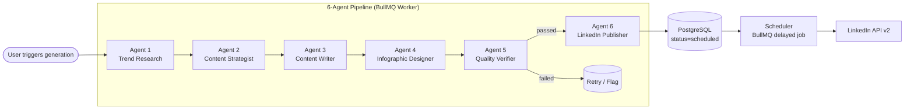

# System Architecture

## Overview

InfographAI is a **multi-agent SaaS platform** built as a Turborepo monorepo. The core value is the 6-agent pipeline that transforms a niche + topic into a published LinkedIn infographic with zero manual effort.

---

## Agent Pipeline



---

## Agent Responsibilities

| # | Agent | Model | Responsibility |
|---|---|---|---|
| 1 | Trend Research | GPT-4o + web APIs | Scans GitHub, HN, Reddit → selects top topic |
| 2 | Content Strategist | GPT-4o | Hook, LinkedIn angle, content format |
| 3 | Content Writer | GPT-4o | Infographic body, caption, CTA |
| 4 | Infographic Designer | SVG template + GPT-4o images | SVG generation → PNG → S3 |
| 5 | Quality Verifier | Claude 3.5 Sonnet | Technical accuracy, grammar, brand safety |
| 6 | LinkedIn Publisher | GPT-4o-mini | Hashtag generation, post formatting |

> Using **Claude** for quality verification provides genuine model independence from the GPT-4o generation agents — a different model with different training data checking the work.

---

## Data Flow

```
User Input (niche, optional topic)
    │
    ▼
POST /infographics          ← REST API
    │
    ▼
BullMQ job: agent-pipeline  ← Redis queue
    │
    ├── TrendResearchAgent   → { topic, importance, audience }
    ├── ContentStrategistAgent → { hook, angle, keyTakeaways }
    ├── ContentWriterAgent   → { title, body, caption, cta }
    ├── InfographicDesignerAgent → { svg, imageUrl }
    ├── QualityVerifierAgent → { passed, score, issues }
    └── LinkedInPublisherAgent → { caption, hashtags, linkedinPostBody }
    │
    ▼
Infographic record updated (status=scheduled)
    │
    ▼
Delayed BullMQ job fires at scheduledAt
    │
    ▼
LinkedIn API v2: UGC Post created
```

---

## Database Schema

```
users
 ├── id (uuid PK)
 ├── email
 ├── plan (free | pro | enterprise)
 └── linkedinAccessToken (encrypted)

infographics
 ├── id (uuid PK)
 ├── userId (FK → users)
 ├── niche
 ├── topic
 ├── status (enum — 8 states)
 ├── hook, bodyContent, caption, hashtags[]
 ├── imageUrl (S3)
 ├── svgSource
 ├── agentTrace (JSONB — full pipeline output)
 ├── scheduledAt, publishedAt
 └── linkedinPostId
```

---

## Request Flow (API)

```
Client → JWT Auth Guard → Controller → Service → BullMQ Queue
                                              ↓
                                       Worker Process
                                              ↓
                                    Agent 1 → 2 → 3 → 4 → 5 → 6
                                              ↓
                                       DB update (each step)
                                              ↓
                                    SSE event → Client (real-time)
```

---

## Real-time Progress (Server-Sent Events)

Each agent step emits an SSE event so the frontend can show live pipeline progress:

```
GET /infographics/:id/stream
Content-Type: text/event-stream

data: {"agentId":"trend-research","status":"running"}
data: {"agentId":"trend-research","status":"completed","durationMs":2340}
data: {"agentId":"content-strategist","status":"running"}
...
```

---

## Security Considerations

- JWT authentication on all API endpoints
- LinkedIn OAuth tokens stored encrypted (AES-256) in PostgreSQL
- S3 objects served via pre-signed URLs (not public)
- API keys stored in environment variables, never in code
- CORS restricted to known origins
- Input validation with `class-validator` (NestJS) and `zod` (Next.js)
- BullMQ jobs do not contain raw secrets — only IDs

---

## Scalability

| Concern | Solution |
|---|---|
| High generation volume | Horizontal BullMQ workers, concurrency per queue |
| Slow LLM calls | Async queue — API returns immediately, client polls/SSE |
| S3 egress cost | CDN in front of S3 (CloudFront) |
| Rate limits (LinkedIn API) | Per-user token buckets in Redis |
| Multi-tenancy | Row-level security, userId on all queries |
